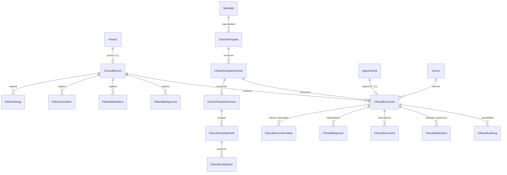

# NEXARIS LINK — Arquitectura del Módulo de Historia Clínica Electrónica (EHR)
**Cliente:** SurHospital  
**Rol:** Senior Software Engineer & Healthcare Software Architect  
**Fecha:** Octubre 2026  
**Versión:** 1.0.0-PROD  

---

## 1. Visión General del Módulo

El Módulo de Historia Clínica de **Nexaris Link** para **SurHospital** implementa una arquitectura desacoplada, flexible y altamente auditable orientada a la atención ambulatoria y hospitalaria moderna.

A diferencia de los sistemas tradicionales rígidos con esquemas estáticos o modelos EAV caóticos no indexados, este módulo se basa en la separación estricta de tres dimensiones esenciales del cuidado de la salud:

```
+-----------------------------------------------------------------------------------+
|                              1. CLINICAL RECORD                                   |
|               (Historia Clínica Longitudinal / Registro Permanente)                |
|  - Alergias y Alertas Críticas (PatientAllergies)                                 |
|  - Antecedentes Personales, Familiares, Quirúrgicos, Hábitos (PatientBackgrounds) |
|  - Condiciones y Enfermedades Crónicas (PatientConditions)                        |
|  - Medicación Habitual (PatientMedications)                                       |
+-----------------------------------------------------------------------------------+
                                         │
                                         ▼
+-----------------------------------------------------------------------------------+
|                              2. CLINICAL ENCOUNTER                                |
|                        (Episodio de Atención Médica / Acto)                       |
|  - Vinculado a Cita (Appointment), Médico (Doctor), Paciente y Especialidad       |
|  - Basado en una versión inmutable de plantilla (ClinicalTemplateVersion)         |
|  - Estados: DRAFT -> IN_PROGRESS -> FINALIZED -> AMENDED (Addendums)              |
|  - Valores de Campos Dinámicos (ClinicalEncounterValues)                          |
|  - Diagnósticos Estructurados (ClinicalDiagnoses: CIE-10 / Tipo)                  |
|  - Documentos Adjuntos Seguros (ClinicalDocuments)                                |
|  - Adendas Clínicas Inmutables (ClinicalAddendums)                                |
+-----------------------------------------------------------------------------------+
                                         ▲
                                         │ (Define estructura de captura)
+-----------------------------------------------------------------------------------+
|                             3. CLINICAL TEMPLATE                                  |
|                      (Motor de Plantillas Dinámicas Versionadas)                  |
|  - Plantillas por Especialidad (Cardiología, Pediatría, Medicina General, etc.)  |
|  - Versiones Inmutables Publicadas (v1, v2, v3...)                                |
|  - Secciones Dinámicas Ordenables y Repetibles (ClinicalTemplateSections)         |
|  - Campos Tipados con Reglas de Validación (ClinicalTemplateFields & Options)     |
|  - Control de Visibilidad por Rol (Doctor, Admin, Reception, Patient)            |
+-----------------------------------------------------------------------------------+
```

---

## 2. Principios de Diseño Arquitectónico

### 2.1 Inmutabilidad Asistencial y Legal
1. **Plantillas Publicadas Inmutables**: Una vez que una versión de plantilla (`ClinicalTemplateVersion`) pasa a estado `PUBLISHED`, su estructura de secciones y campos no se puede modificar ni eliminar. Cualquier edición genera automáticamente una nueva versión (`vN+1`) en borrador.
2. **Consultas Históricas Preservadas**: Toda atención médica (`ClinicalEncounter`) queda permanentemente ligada al `template_version_id` con el que fue realizada. Si la plantilla evoluciona a `v2`, las atenciones previas en `v1` se siguen renderizando e interpretando con la estructura exacta de `v1`.
3. **Bloqueo tras Finalización (`FINALIZED`)**: Cuando un médico finaliza una atención, el registro se sella criptográfica y lógicamente. Ningún campo puede ser editado directamente.
4. **Adendas Clínicas (`ClinicalAddendum`)**: Cualquier aclaración, corrección o fe de erratas posterior a la finalización se realiza mediante una adenda firmada con autor, fecha, motivo y contenido, sin alterar jamás el documento original.

### 2.2 Modelo Híbrido Relacional + Tipado Estructurado
Para evitar la trampa del anti-patrón EAV (Entity-Attribute-Value) descontrolado y mantener alto rendimiento en MySQL / PostgreSQL:
- La información de consulta frecuente, indexación y alertas médicas críticas (alergias, diagnósticos, condiciones crónicas, medicaciones) reside en **tablas normalizadas dedicadas**.
- Los valores dinámicos de formularios de especialidad se capturan mediante `clinical_encounter_values` con columnas tipadas (`value_text`, `value_number`, `value_date`, `value_boolean`, `value_json`) e índices compuestos optimizados.

### 2.3 Seguridad de Grado Médico y Privacidad Diferenciada
- **Principle of Least Privilege**: El personal de Recepción (`reception`) tiene acceso a la gestión de citas y flujo del paciente, pero las notas clínicas sensibles, diagnósticos y exploraciones físicas están protegidas y enmascaradas en backend.
- **Portal del Paciente**: Los pacientes solo acceden a las secciones y campos explícitamente marcados como `is_patient_visible = true`.
- **Datos Sensibles (`is_sensitive`)**: Tratamiento restringido que previene fugas en logs de aplicación y vistas administrativas no autorizadas.

---

## 3. Diagrama de Relaciones Entidad-Relación



---

## 4. Servicios del Dominio Clínico (`App\Services\Clinical`)

1. **`ClinicalRecordService`**:
   - Inicialización / obtención garantizada de `ClinicalRecord` por paciente.
   - Gestión de Alergias (con detección y propagación de `ClinicalAlert`), Condiciones, Medicación y Antecedentes.
   - Cálculo del Resumen Clínico Longitudinal.

2. **`ClinicalTemplateService`**:
   - Creación y clonación de plantillas.
   - Publicación y versionado inmutable (`publishVersion`, `createNewVersionDraft`).
   - Gestión de secciones y campos con reordenamiento persistente.
   - Renderizado dinámico de preview y validación de esquemas.

3. **`ClinicalEncounterService`**:
   - Inicio de consulta médica desde cita (`startEncounterFromAppointment`).
   - Guardado de borrador (`saveDraftValues`).
   - Motor de validación según reglas activas del `ClinicalTemplateVersion`.
   - Finalización de atención (`finalizeEncounter`), sellado y registro de auditoría.
   - Emisión de adendas clínicas (`createAddendum`).

4. **`ClinicalDocumentService`**:
   - Carga segura de documentos clínicos a storage privado (`medical_records`).
   - Validación estricta de MIME types (PDF, JPEG, PNG, DICOM/ZIP) y escaneo de integridad.
